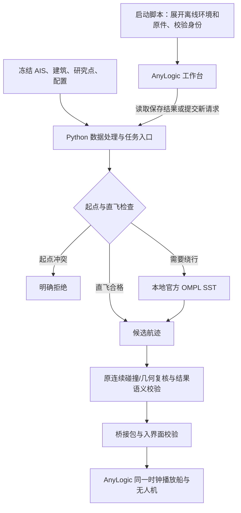

# 设计说明

[回到启动入口](../../README.md) · [测试](测试说明.md) · [风险](风险与限制.md) · [演示](演示顺序.md)

当前实现解决一个固定问题：在维港历史船位与建筑约束下，一架无人机从指定海上巡航点按固定时刻出发，能否找到合格航迹。八个点、四条任务被冻结，计算为二维；AnyLogic 三维用于观察结果。

## 核心结构

图中是职责关系；搜索无合格解、校验失败或作业错误均走失败路径，不显示旧成功路线。读取保存案例走结果加载校验，不重新执行搜索。

| 部分 | 当前入口 | 这样设计的理由 |
|---|---|---|
| 准备与启动 | [`start.cmd`](../../start.cmd)、[`start_project.ps1`](../../scripts/start_project.ps1)、[`start_full_demo.py`](../../start_full_demo.py) | 随库展开 Python/原件；按本机发现 AnyLogic，生成本目录模型，减少原作者电脑路径依赖。 |
| 观测与任务 | [`ais_replay.py`](../../src/ais_replay.py)、[`ais_single_task.py`](../../src/ais_single_task.py) | 保存原始来源；区分实测、合格片段插值和未知；固定请求可追溯，不为成功自动换时刻。 |
| 求解与复核 | [`ompl_sst.py`](../../src/ompl_sst.py)、[`sst_probe.cpp`](../../runtime/ompl/sst_probe.cpp)、[`safe_planning.py`](../../src/safe_planning.py) | 直飞合格就直接飞；需要绕行时调用官方 OMPL 2.0.2 `control::SST`，没有旧自编搜索回退；库输出仍须通过项目原约束。 |
| 结果与显示边界 | [`validation.py`](../../src/validation.py)、[`release_checks.py`](../../src/release_checks.py)、[`anylogic_workspace.py`](../../src/anylogic_workspace.py)、[`ais_anylogic_bridge.py`](../../ais_anylogic_bridge.py) | 校验状态、航程、端点、速度、时间、来源与重复字段；从冻结原件重算八点/锚点及地图边界，拒绝矛盾成功和错误派生显示。 |
| 原生展示 | [`NativeWorkbench.java`](../../anylogic/NativeWorkbench.java)、[`ResultPacket.java`](../../anylogic/ResultPacket.java)、[`NativeDemoView.java`](../../anylogic/NativeDemoView.java) | Python 保留计算，AnyLogic 复用结果和时钟；成功入界面前再守卫，失败清旧路线并恢复操作。三维没有第二套寻路算法。 |

## 数据、数值与结果怎样理解

船位唯一来源是已保存的 AISStream 历史接收记录；建筑、码头锚点和背景来自既有官方快照。当前启动和播放不接在线船位或底图，不需要密钥。具体接口、样本统计、来源和许可证位置见 [README 的 API 说明](../../README.md#接入了哪些-api-和数据)。

规划使用 EPSG:32650 米制坐标，恒速 15 m/s、船位参考点避让半径 90 m、建筑包络外 30 m，沿用原研究配置。90 m 来自样本船体参考包络 60 m 加研究净距 30 m；不代表真实船舷净距或飞行许可。全部数值解释保留在 [README](../../README.md#各种数值为什么这样设) 和 [`parameter-sources.json`](../../config/parameter-sources.json)，实际 SST 设置见 [`settings.json`](../../runtime/ompl/settings.json)。

相邻有效观测间隔不超过 120 秒才在合格片段内插值；长缺口、观测首末之外未知，不外推。未知不参与避障，也不因缺口本身拒绝任务，这是已确认的研究假设。成功只说明通过已观测模型约束。

## 接手时保持的边界

- 原始消息、冻结点、配置与保存结果有来源/哈希；不能修改它们或更新清单来掩盖验收失败。离线包还原到 `data/`、`output/`，会话与日志放在 `.local/`。
- 16 个保存入口中 10 个可重算、6 个只读；只读中包含历史对照和未运行条目。它们不等于 16 个独立成功实验。
- 播放倍率、相机和楼体只影响显示。楼高、无人机显示高度不参与二维飞越判定；未建模垂直起降、加速度、转弯半径、天气和多机控制。

本说明按 F26 实现核对，本次只整理文档；函数行号和源码哈希见 [F26 映射](../F26/code-map.json)。
